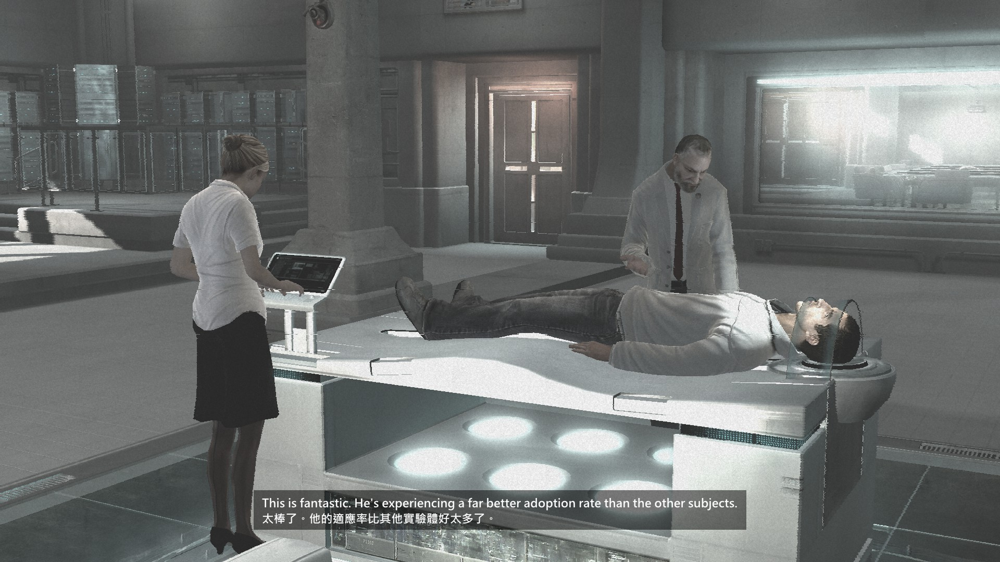

# 刺客教條 1（Steam 導演剪輯版）英中雙語字幕安裝指南

讓 Steam 版《刺客教條》一代在對話時顯示「上英文、下繁體中文」的雙語字幕，並整理實測踩過的坑。

> **本 repo 不含任何遊戲對白或翻譯文字。** 字幕內容屬於遊戲版權方，這裡只提供安裝步驟、設定修改、工具腳本與譯名對照表。字幕檔請自行準備（見「字幕檔從哪來」）。

## 成品



| 項目 | 狀態 |
|---|---|
| 對話字幕 | 上英下中雙語，時間點與原版同步 |
| 遊戲介面 | 可選繁中（中文介面外掛可能在古代切回現代時崩潰，見下方地雷 4） |
| 開場影片 | 跳過 |

測試環境：Windows 11、Steam 版 v1.02（`AssassinsCreed_Dx9.exe` MD5 `8E72C3333743780E43BC2C34BBF625F9`）。

## 一鍵安裝

下載本 repo（Code → Download ZIP）解壓後，雙擊 **`install.bat`**。它會依序：

1. 從 Steam 資料庫自動找到遊戲資料夾（找不到會請你貼路徑）
2. 備份原本的 `dinput8.dll` 與 `scripts\` 到遊戲資料夾裡的 `_backup_日期時間\`
3. 從 GitHub 下載並安裝三個 mod（版本固定，見下表）
4. 套用設定：字幕框高度修正、跳過開場影片
5. 把微軟正黑體複製成 `scripts\subtitles.ttf`
6. 問你雙語 `subtitles.json` 放在哪（本 repo 不附字幕內容；跳過的話先維持英文字幕）
7. 問你要不要裝中文介面：要的話會開啟其樂帖子讓你下載中文化包，解壓後貼上資料夾路徑，程式會自動挑出 1024 穩定版外掛與原版繁中字庫
8. 把 Steam 啟動選項複製到剪貼簿，你只要到 Steam 貼上

進階用法（全部參數可省略）：

```bat
install.bat -GameDir "D:\Steam\steamapps\common\Assassins Creed" -SubtitlesJson "D:\subtitles.json" -ChinesePackDir "D:\ac1_cn" -Yes
install.bat -SkipChineseUI
```

## 需要的 mod

全部從原作者處下載，本 repo 不轉載：

| Mod | 用途 | 下載 |
|---|---|---|
| Ultimate ASI Loader | 讓遊戲載入 `.asi` 外掛（用 `dinput8.dll`） | [ThirteenAG/Ultimate-ASI-Loader](https://github.com/ThirteenAG/Ultimate-ASI-Loader/releases) |
| EaglePatchAC1 | 穩定性修正、跳過開場影片 | [Sergeanur/EaglePatch](https://github.com/Sergeanur/EaglePatch/releases) |
| SubtitleSynchAC1 | 依語音事件顯示同步字幕（讀 `subtitles.json`） | [bloxtbc/SubtitleSynchAC1](https://github.com/bloxtbc/SubtitleSynchAC1/releases) |

## 手動安裝步驟

1. **先備份**遊戲資料夾（Steam：右鍵遊戲 → 管理 → 瀏覽本機檔案）。
2. 把 `dinput8.dll` 放進遊戲根目錄。
3. 在遊戲根目錄建立 `scripts\`，放入：
   - `EaglePatchAC1.asi`、`EaglePatchAC1.ini`
   - `SubtitleSynchAC1.asi`、`SubtitleSynchAC1.ini`、`subtitles.json`、`subtitles.ttf`
4. 套用下面的設定修改。
5. 用雙語 `subtitles.json` 取代原本的英文版，並把 `subtitles.ttf` 換成含中文字的字型。
6. Steam 啟動選項設成直接跑 DX9（見地雷 1）。

### 設定修改

`scripts\SubtitleSynchAC1.ini`（完整檔案見 [`config/SubtitleSynchAC1.ini`](config/SubtitleSynchAC1.ini)）：

```ini
PaddingX=32
PaddingY=16
```

`scripts\EaglePatchAC1.ini`：

```ini
SkipIntroVideos=1
```

字型：把系統的微軟正黑體粗體複製過去改名即可（僅限自己電腦使用，字型授權不允許轉散布）：

```bat
copy C:\Windows\Fonts\msjhbd.ttc "<遊戲資料夾>\scripts\subtitles.ttf"
```

SubtitleSynchAC1 會載入 U+0000–U+FFFF 範圍的字形，所以中日韓字型可以直接用。

## 地雷

1. **只能跑 DX9。** Steam 預設啟動的 `AssassinsCreed_Game.exe` 在 Windows 10/11 會選 DX10，mod 不支援，結果是按下「開始」幾秒就跳回來。Steam → 內容 → 啟動選項填：
   ```
   "<遊戲資料夾>\AssassinsCreed_Dx9.exe" %command%
   ```
2. **雙語第二行被裁掉。** SubtitleSynchAC1 預設 `PaddingY=-25`，字幕框高度 = 文字高度 + PaddingY，單行英文靠 ImGui 最小視窗高度撐住，兩行就會被切掉下面那行。改成正數。
3. **中文顯示成問號或空白。** 附帶的 `subtitles.ttf` 只有拉丁字母，要換成 CJK 字型。
4. **中文介面外掛會崩潰。** 坊間流傳的中文介面包（`LG_AC.asi`，2008 年官方繁中文字）會讓遊戲在 `AssassinsCreed_Dx9.exe+0x54652` 發生存取違規。逐一停用 mod 實測：只有載入它時會崩，其他 mod 單獨都正常。快取 2048 版開機就當，1024 版能玩一陣子，但從古代記憶切回現代時容易當。
   - 除錯器抓到的現場：遊戲背景工作執行緒（`exe+0x57150` 的佇列迴圈）呼叫一個已被釋放的物件；呼叫鏈上沒有 `LG_AC` 自己的程式碼。
   - 已排除：網路連線（加網路封鎖仍當）、CPU 核心數（限 4 核仍 2/3 當）、顯示驅動（換 DXVK 3.1.1 仍 3/4 當）。
   - 實用解法：平常開著中文介面；遇到切回現代就當的段落，關遊戲 → 執行 `tools\toggle-chinese-ui.bat` 關閉 → 讀檔過關 → 再開回來。存檔不受影響。
5. **OneDrive 會被暫停。** Windows 遊戲模式偵測到遊戲時會暫停 OneDrive 同步，遊戲崩潰退出後不會自動恢復。解法：遊戲中按 `Win + G` → 設定 → 取消勾選「記住這是遊戲」，或手動按 OneDrive「繼續同步」。

## 字幕檔從哪來

https://mega.nz/file/qRYXTRDA#fQ49BNxmMSCQbZpbU1-u9A4AatkWXrCyVXlQEvtADfc 中英文字幕

`subtitles.json` 格式是「音效 ID → 字幕文字」，文字中用 `<wait=秒數>` 分段、`<duration=秒數>` 結尾：

```json
{
  "0x20a800e9": "第一段 <wait=1.5> 第二段 <duration=3.0>"
}
```

做法：

1. 從 SubtitleSynchAC1 取得英文 `subtitles.json`。
2. 產生一份 key 相同、只有中文的 `zh.json`。每句的 `<wait>`／`<duration>` 標記必須和英文原句完全一致、順序相同。
3. 用本 repo 的工具合併成雙語：
   ```bash
   python tools/make_bilingual.py subtitles.en.json zh.json subtitles.json
   ```
   工具會逐句比對時間標記，對不上的句子保留英文並列出來。

譯名建議見 [`docs/glossary.md`](docs/glossary.md)。

## 工具

| 檔案 | 用途 |
|---|---|
| [`tools/make_bilingual.py`](tools/make_bilingual.py) | 英文＋中文 JSON 合併成上英下中雙語，並檢查時間標記 |
| [`tools/restore-english.bat`](tools/restore-english.bat) | 移除 `dinput8.dll` 與 `scripts\`，回到原版 |
| [`tools/toggle-chinese-ui.bat`](tools/toggle-chinese-ui.bat) | 若你仍想試中文介面外掛，用來快速開關 `LG_AC.asi` |

兩個 `.bat` 開頭的 `GAME` 變數請改成自己的遊戲路徑。

## 授權

本 repo 的程式與文件採 [MIT](LICENSE)。各 mod 依其原作者授權；遊戲內容版權屬 Ubisoft。
